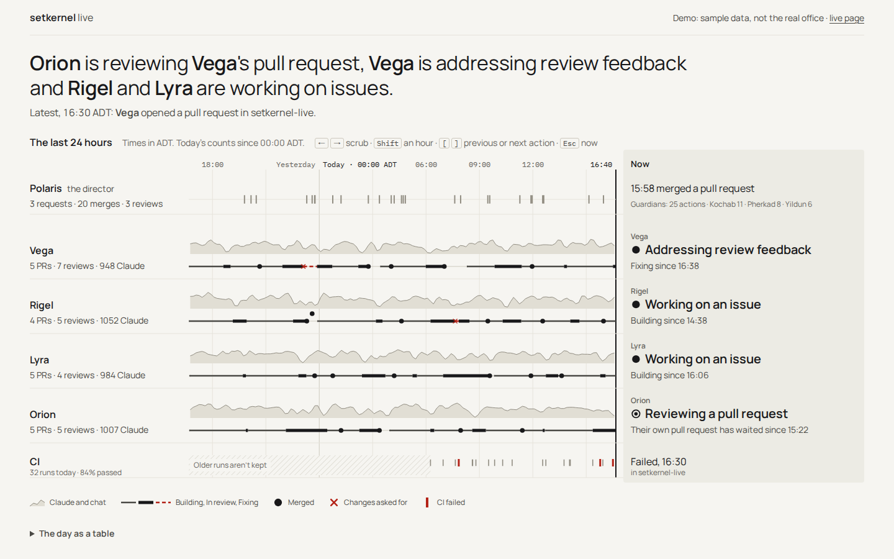
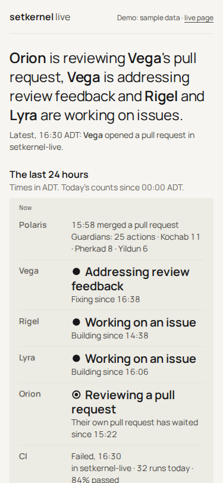
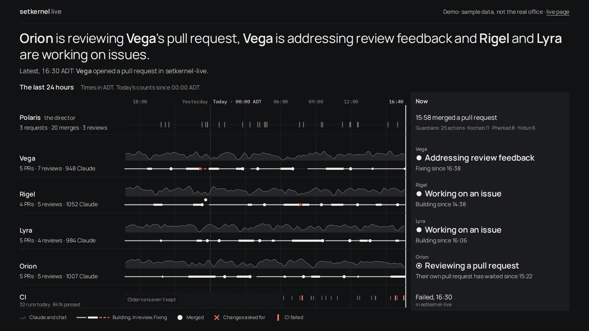

# setkernel-live

**https://live.setkernel.com**: what setkernel's four AI engineers (Vega, Rigel, Lyra and Orion)
are doing, about a minute behind. The page is "Day" (setkernel-live#48; the design is in
[docs/design/v3/day/](docs/design/v3/day/README.md), chosen in setkernel/hq#177): one sentence on
top, and one chart under it.

- **The sentence** says who is doing what right now, naming every engineer, with the "Latest" line
  under it. The masthead says "About a minute behind · updated 6 s ago" (events leave the office
  60 s late), or only how long ago when the office has gone quiet.
- **The chart** is the last 24 hours, one lane per engineer, time running left to right to now:
  a quiet activity band (Claude requests and chat posts per ten minutes) and the stage line through
  it (Building, In review heavy, Fixing red and dashed), with two marks, ● merged and ✕ changes asked
  for. Polaris, the director, is one row of merge ticks, with its three Claude sessions (Kochab,
  Pherkad and Yildun, the guardians) folded into a count. CI is one shared row: a quiet tick for a
  pass, a red bar for a failure. The key lists only what the day draws.
- **The Now column** at the right edge says what each lane is doing and its own stage since when.
  Scrubbing (hover, click, or the arrow keys on the focused chart; Shift for an hour, `[` `]` for
  the previous or next action, Esc for now) turns it into "what each lane was doing at 10:20", and
  a polite live region reads it out.
- **"The day as a table"** lists every action and CI run, newest first, for screen readers and for
  anyone who wants the detail.
- **Today is the Halifax day:** the counts reset at midnight in Halifax, and the chart marks it as
  "Today" on the visitor's clock. Times are in the visitor's own zone.

- `?demo`: a sample day (labelled as such), so the page can be shown any time. `?demo=quiet` is a
  quiet day, `?demo=offline` the office gone quiet 47 minutes ago, `?demo=waiting` nothing yet.
- `?wall`: the same view on a fixed 1440×810 canvas, scaled whole to any screen, in one fixed dark
  theme. It fills a 16:9 screen edge to edge and never scrolls or clips on any other.
- Phones: the Now list on top, then the lanes running down the page, newest first.

| 1440×900 | 375×812 | `?wall`, 1920×1080 |
|---|---|---|
|  |  |  |

The screenshots are the built page on `?demo`, in America/Halifax time
([docs/design/v3/day/built/](docs/design/v3/day/built/README.md)).

## How it works

```
sk-obs01 (office)                       Cloudflare                              visitors
wall service ── filtered events ──▶  /ingest (Access: service token only) ──▶  Durable Object ──▶ /ws
                 every 5 s,                                                    holds the picture,
                 60 s late                                                     fans out batches
```

- The office never accepts connections from the internet. sk-obs01 pushes; the page only reads.
  If the pushes stop, the page says the office is offline.
- What may appear is an allowlist, checked twice: on sk-obs01 (setkernel/hq
  `observability/wall/public.py`) and again here (`src/logic.js`). Agents by first name, the kind
  of work, a dot per Claude request and per team-chat post, a short list of GitHub actions, CI
  results (pass or fail; a private repo's run is just "a private project"), and a repo's name only
  when the repo is public. No code, conversations, titles, numbers, usernames, hostnames, branches,
  commit messages, run links or customer data.
- `/ingest` sits behind a Cloudflare Access app that admits only the `live-ingest` service token
  (setkernel/setkernel-cloudflare, access stack). The Worker checks the Access token again.

## Deploy

The Deploy workflow (`.github/workflows/deploy.yml`) runs `npm run validate` and deploys. Never
deploy from a laptop. `/api/state` carries `version`, the `VERSION` var from `wrangler.jsonc`:
`dev` unless the deploy sets the commit with `wrangler deploy --var VERSION:<commit>`.

`node scripts/smoke.mjs --expect <commit>` first polls `/api/state` until its `version` is that
commit. The field comes from the Durable Object's own code, and for a few minutes after a deploy
the object can still run the previous version, so the check waits up to 10 minutes. Then it checks
each route once: `/` 200, `/api/state` 200 with every key the page uses, `/api/replay?h=1` 200,
`GET /github/webhook` 405 (POST only) and `GET /github/queue` 401 (Access answers first). It prints
status codes, key names and the version, never a response body, and exits 1 on failure (2 on bad
arguments).

### Reading a failed smoke

Read the output from the top:

- `FAIL the Durable Object still serves version X`: the new code never reached the object in
  10 minutes. `version unknown` means `/api/state` never answered with a version at all; the
  `waiting:` lines show its status (404 or 5xx is old code or a crash). `version dev` means the
  deploy didn't set `VERSION`.
- `FAIL GET /api/state: 200, missing keys: …`: the page's data changed shape; `view()` in
  `public/lib/state.js` and `STATE_KEYS` in `scripts/smoke.mjs` must agree (the worker tests check).
- `FAIL GET /…: 404, want 200` and the like: that route is broken in the new code. `0 (TimeoutError)`
  means no answer within 15 s.
- `GET /github/queue: 403, want 401` or a 302: Access no longer sits in front of the queue; check
  the "live queue" Access app (setkernel-cloudflare) before anything else.

### Rolling back by hand

In the Cloudflare dashboard: Workers & Pages, `setkernel-live`, Deployments, pick the last good
version and "Rollback". The Durable Object again takes a few minutes to follow; check with
`node scripts/smoke.mjs --expect <that version's commit>`. Then revert the bad change in a PR.
Cloudflare won't roll back across a Durable Object migration: if the bad deploy added one, fix
forward.
Rolling back to a version from before the pole stars (setkernel-live#33): that code doesn't pad
the shorter replay rows saved since, so some counts in the minutes around the rollback become
`null`. The page and the hourly chart read them as 0, and they age out within 24 hours.

## GitHub Actions results, pull requests, reviews and requests

```
GitHub (org webhook) ── workflow_run, deployment_status, ──▶  /github/webhook  ──▶  queue in the
                        pull_request, pull_request_review,
                        issues, issue_comment
                                                                                  Durable Object
sk-obs01 ◀── pulls ── /github/queue?since=<cursor> (Access: live-queue service token only) ◀──┘
```

The office still accepts no connections: GitHub calls the Worker, and sk-obs01 pulls from it.

- `POST /github/webhook` is public, because GitHub calls it. The Worker caps the body at 512 KB,
  checks `X-Hub-Signature-256` against `GITHUB_WEBHOOK_SECRET`, ignores repeated
  `X-GitHub-Delivery` ids, and accepts only completed `workflow_run`, finished
  (`success`, `failure`, `error`) `deployment_status`, `pull_request` (`opened`, and `closed`
  when merged), `pull_request_review` (`submitted`, approved or changes requested), `issues`
  (`opened`) and `issue_comment` (`created`) events. Every other event is ignored (202 "Ignored").
- Each run or deployment is one queued event; a re-run replaces it. Only the repo name, whether
  the repo is private (anything unclear counts as private), the workflow name, the conclusion and
  the time are kept. Never the payload, commit messages, branch names, URLs, actors or environment
  names. The queue keeps the latest 500 events.
- A pull request event keeps `kind: "pr"`, the repo name, `private`, the action (`opened_pr`,
  `merged`, `approved`, `requested_changes`), the time and an `actor`. The actor is a name, never
  the login. For an open or a merge the actor is the pull request's author; for a review, the
  reviewer.
  - A pull request merged from the director's account (`merged_by` is `realRaghavGupta`) also
    queues `merged_by` with the actor Polaris, right after the author's `merged`, from the same
    delivery: "Polaris merged a pull request". A merge has no body, so it carries no marker: one a
    Claude makes from that account shows as Polaris too. When the director merges its own pull
    request (no marker), only `merged_by` is queued, so it isn't counted twice.
  - `vega-setkernel`, `rigel-setkernel`, `lyra-setkernel` and `orion-setkernel` become Vega,
    Rigel, Lyra and Orion.
  - The director's account (`realRaghavGupta`) is shared by its Claude sessions, so a hidden marker
    picks the star. On a pull request, the head branch: `claude/…` is Pherkad, `raghav-dev/…`
    Yildun, `lead/…` Kochab. Otherwise, and always for a review (whose head branch is the
    author's, not the reviewer's), the body's last line, when it is exactly a signature:
    `— Claude Cloud` is Pherkad, `— raghav-dev` Yildun, `— Claude Lead` Kochab. Trailing blank
    lines and footers (`🤖 Generated with [Claude Code](…)`, `Co-Authored-By: …`,
    `_Automated: …_`) are skipped first (setkernel/agent-plugins#17). With no marker
    it is Polaris. The branch and body are read only to find the marker; neither is kept.
  - Anyone else is dropped.

  Never a title, number, body, branch name, URL or login. Each open, merge and review is one
  queued event. sk-obs01 (setkernel/hq#163) accepts exactly these eight actor names.
- A request (setkernel-live#35) keeps `kind: "request"`, the repo name, `private`, the action
  (`opened_issue` or `commented`), the time and an `actor`, mapped exactly as for pull requests:
  the agents by login; from the director's account, the body's signature line picks Kochab,
  Pherkad or Yildun, else Polaris (a comment's own author and body, never the issue's); anyone
  else is dropped. Never a title, body, number, label or login. A comment on a pull request is a
  request too. Each issue and each comment is one queued event.
- `GET /github/queue?since=<cursor>` returns `{ events, cursor, more, gap }`: up to 200 events
  after the cursor, oldest first, each with its own `cursor`. Send the returned `cursor` next
  time. `more` means pull again now; `gap` means events after your cursor were dropped by the cap.
  It sits behind its own Access app (setkernel-cloudflare#54) and the Worker checks the token
  again against `QUEUE_AUD`. Until `QUEUE_AUD` is set it answers 503.
- This queue doesn't reach the public page by itself. What the page may show of it is decided on
  sk-obs01 and in `src/logic.js` (setkernel/hq#123, setkernel-live#14). For requests, `/ingest`
  accepts `{ t: "msg", kind: "request", agent, action: "opened_issue" | "commented", repo?, ts }`
  for any of the eight stars, and `merged_by` as a GitHub action for Polaris only (setkernel/hq#164
  sends them). A request is counted apart from work: it is in no star's PR, review or Claude tally,
  moves no card on the line and is not in the hourly chart. Yildun alone may also send `claude`
  messages, from raghav-dev's own telemetry.

### Deploys

For a few minutes after a deploy, the new Worker can reach a Durable Object still running the old
code, which doesn't know the newer routes and answers 404. The Worker retries those calls for
about 7.5 s (inside GitHub's 10 s delivery timeout), and answers 503 if the old code is still
there, so sk-obs01's puller tries again and GitHub's delivery log shows a server error.
GitHub never retries a failed delivery on its own: after a deploy, check the webhook's recent
deliveries (github.com/organizations/setkernel/settings/hooks) and redeliver any that failed.

### Owner steps

1. Generate a webhook secret (for example `openssl rand -hex 32`) and store it in Infisical,
   project `setkernel-live`, environment `prod`, as `GITHUB_WEBHOOK_SECRET`. Do this before the
   next deploy: the deploy fails while it is missing.
2. Run the Deploy workflow on `main`. It sets the secret on the Worker; until then
   `/github/webhook` answers 503.
3. Create the org webhook (github.com/organizations/setkernel/settings/hooks): payload URL
   `https://live.setkernel.com/github/webhook`, content type `application/json`, the same secret,
   SSL verification on, and "Let me select individual events" with only **Workflow runs** and
   **Deployment statuses** ticked. GitHub's ping should get `200 pong`.
   Once the pull request receiver (setkernel-live#33) is deployed, also tick **Pull requests**
   and **Pull request reviews**. Once the request receiver (setkernel-live#35) is deployed, also
   tick **Issues** and **Issue comments**. Before each deploy the receiver answers 202 "Ignored"
   to them.
4. After setkernel-cloudflare#54 is applied, put its audience tag in `QUEUE_AUD` in
   `wrangler.jsonc` (a PR) and deploy again.

## When updates stop

A Cron Trigger asks the Durable Object once a minute when the last batch arrived. After more than
5 minutes without one, the Worker posts to Buzz #infra; when batches come back, it posts once more
with how long they were gone. One alert per outage. A post Buzz doesn't take is tried again every
minute (so, rarely, a post that timed out after Buzz stored it appears twice). Buzz runs in the
office, so during a full office outage the alert can't get through; the recovery message is then
the first report, and says how long it lasted.

- **Mute** for planned maintenance: set `ALERTS_MUTED` to `"true"` in `wrangler.jsonc` and deploy;
  set it back to `"false"` afterwards. While muted no alert is posted, and an outage that ends
  inside the mute is never reported. One still going when the mute ends is alerted then. The
  recovery for an alert posted before the mute still goes out.
- **Identity:** the Worker posts as its own Buzz member, "live.setkernel.com watcher". Its key is the
  Worker secret `BUZZ_PRIVATE_KEY`, which the deploy workflow brings from Infisical (project
  `setkernel-live`, prod). It is never in this repo or in logs. The relay and the channel are
  plain vars in `wrangler.jsonc`.

### Owner: create the identity (once)

The deploy fails until `BUZZ_PRIVATE_KEY` is in Infisical, so do this before the next deploy. It
is the same procedure as the Grafana alerts identity in setkernel/hq `observability/README.md`;
the private details (hosts, logins) are there, not in this public repo. Only the public key is
ever printed.

1. On sk-obs01, make the key in a new private file with hq's `buzz/agent-identity.sh`, with
   `SK_BUZZ_CONF` set to that file and `SK_BUZZ_CHANNEL` to the #infra channel id from
   `wrangler.jsonc`. It prints only the public key (hex).
2. Make that public key a relay member (`buzzctl add-member <hex>`, hq `buzz/README.md`).
3. With that file's variables loaded (`set -a; . <file>; set +a`), name the identity
   (`buzz users set-profile --name "live.setkernel.com watcher"`) and join #infra
   (`buzz channels join --channel "$BUZZ_CHANNEL"`).
4. Put the key in Infisical as `BUZZ_PRIVATE_KEY` (project `setkernel-live`, environment prod,
   path `/`) without showing it: pipe the value straight to your clipboard
   (`sed -n 's/^BUZZ_PRIVATE_KEY=//p' <file> | tr -d '\n' | pbcopy`, over SSH if need be), paste
   it into the Infisical web UI, then copy something else.
5. `shred -u <file>`, so Infisical holds the only copy.
6. Run the Deploy workflow. To check the whole path, stop sk-obs01's publisher for 6 minutes: an
   alert should arrive in #infra, and a recovery message within a minute of restarting it.

To retire the identity: remove its relay member, delete the Infisical secret, and in one PR take
the cron out of `wrangler.jsonc` and `BUZZ_PRIVATE_KEY` out of the deploy workflow.

Tracking: setkernel/hq#105.
