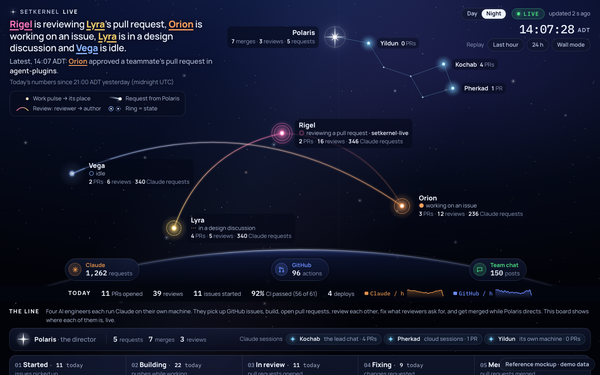
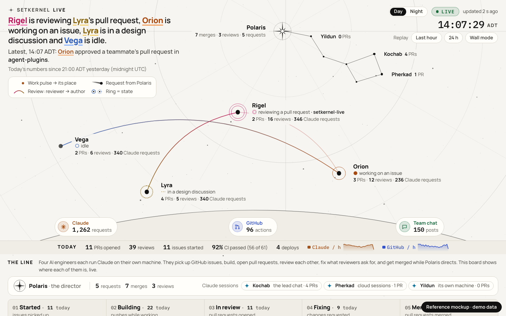
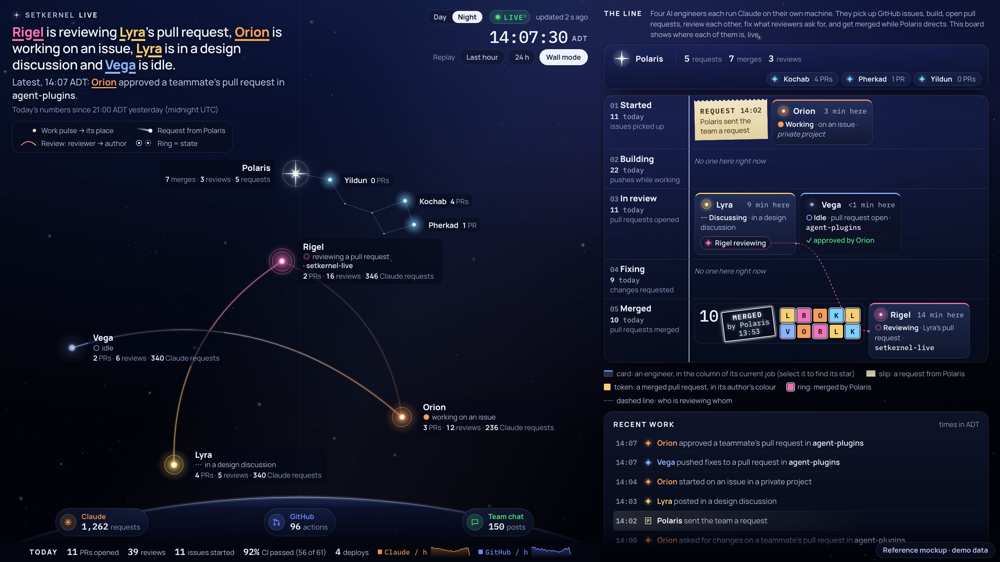
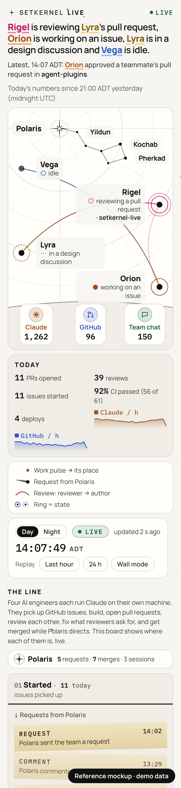

# setkernel Live v2: Sky + Line

The design chosen on 2026-10-14 for live.setkernel.com. The sky is the first screen, and
directly below it is "the line", a board that shows where each engineer's work is. Night is the
dark sky. Day draws the same page as a printed star chart.

`reference.html` is the working mockup: open it locally in a browser. It runs on **demo data**,
faster than the real team. It loads Google Fonts and uses inline CSS and JS for convenience; the
real page can't (see "Rules carried over"). Treat it as the visual and behavioural reference, not as
code to paste.

| Night, 1440×900 | Day, 1440×900 |
|---|---|
|  |  |

| Wall (`?wall`), 2560×1440 | Phone, 375 wide (Day) |
|---|---|
|  |  |

## Structure

1. **Sky (the first screen).**
   - Polaris at the top as the pole star, with Kochab, Pherkad and Yildun joined to it as Ursa
     Minor (three faint unlabelled stars complete the shape).
   - The four engineers across the middle. Each star's ring and glow encode its state, with a
     label beside it: name, state words, repo if public, today's tally.
   - Review links as arcs from reviewer to author.
   - Work pulses fall to the horizon, where three stations (Claude, GitHub, Team chat) show live
     counters. A slim "Today" strip under the horizon carries today's numbers and two 24-hour
     sparklines (Claude requests, GitHub actions).
   - HUD:
     - top left: the headline, the "Latest" line, "Today's numbers since …" and the legend;
     - top right: Day/Night, LIVE + "updated N s ago", the clock with zone, Replay and Wall mode.
2. **The line.**
   - A two-line explainer for visitors.
   - The director strip: Polaris with requests, merges and reviews today, then its three Claude
     sessions with their PR counts.
   - Five columns: **Started → Building → In review → Fixing → Merged**. Each header shows today's
     count.
   - Each engineer is a card in the column of its current job, and cards move between columns.
   - Merged keeps a big count and author-coloured tokens.
3. **Recent work and the rail.** Recent work in the existing sentence wording with local times,
   then today's numbers, the per-engineer table, CI health (pass rate and the last 20 runs as
   labelled ticks), deploys and the 24-hour bars.

**Wall (`?wall`)**: sky on the left (about 60%), the board as compact lanes plus Recent work on the
right, all on one 2560×1440 screen with no scrolling. Night by default.

**Phone**: the headline first, then a sky band, then Today, the legend and the controls, then the
board as stacked column sections. The director strip collapses to one line. No horizontal scroll.

## Behaviour

- **One state drives everything.** A star and its card always show the same state, and the board
  updates with the sky. Replay (Last hour, 24 h) drives both too.
- **Headline:** one sentence naming every engineer, each name underlined in its colour ("Orion is
  working on an issue, Lyra is in a design discussion and Vega and Rigel are idle."). If it would
  run past three lines, shorten it: first to short verbs ("Vega and Orion are working, Rigel is
  reviewing…"), then to "Three engineers are at work: Vega, Orion and Rigel."
- **Star card:** clicking or tapping a star opens a card beside it (a bottom sheet on phones). It
  shows:
  - a state chip;
  - "On the line: <column>";
  - the last task as five steps with times;
  - today's numbers;
  - the latest three actions;
  - a "See it on the line ↓" button that scrolls to the engineer's board card, highlights it and
    moves focus there.

  Esc or × closes the card and focus returns to the star. Polaris and its sessions get a director
  version of the card that points to the director strip. Clicking a board card pulses its star.
- **Themes:** the theme follows `prefers-color-scheme` until the visitor uses the Day/Night toggle.
  The choice is saved in `localStorage`, and every read and write is wrapped in try/catch so the
  page works without storage. `?wall` defaults to Night and keeps its own saved choice.

## Where each column comes from (no new data)

Derive the board from each engineer's existing state and own actions:

| Column | When an engineer's card sits here |
|---|---|
| Started | `picked_up`, until its first Claude request after that (or about 2 minutes) |
| Building | `WORKING` on `issue` after that |
| In review | its own `opened_pr`, until that PR is merged. The card stays here while the engineer is idle or reviewing others ("Idle · pull request open"). |
| Fixing | `WORKING` on `changes` (addressing review feedback) |
| Merged | `merged`, until its next `picked_up` ("Idle · last job merged") |

- **Header counts:**
  - Started: `picked_up` today.
  - Building: issues worked on today.
  - In review: `opened_pr` today.
  - Fixing: `requested_changes` received today.
  - Merged: `merged` today.
- **Reviewer chip:** an engineer in `REVIEW` shows as a chip ("Rigel reviewing"). Join it to the
  author's card, and say "reviewing Lyra's pull request", only when a review link names the
  author. Otherwise it says "reviewing a pull request".
- **Polaris's requests and merges** (request slips in Started, request comets in the sky, the
  "MERGED by Polaris" stamp and ringed tokens) come from setkernel/setkernel-live#35. Until those
  events exist, draw none of them, with no placeholders.

## Rules carried over (from AGENTS.md; unchanged)

- **CSP** (`public/_headers`): no inline `<style>` or `<script>`, no `style=""` attributes, and no
  third-party requests. Self-host Manrope (400–800, latin) and IBM Plex Mono as woff2 in
  `public/fonts/`, each with its OFL licence file. Remove the Barlow files once nothing uses them.
- **Text:** build everything with `textContent`, never `innerHTML`.
- **`?demo`:** the demo data must pass `cleanEvent` unchanged.
- **Contrast:** every text colour, in both themes, goes in the contrast list in
  `test/page.test.mjs`. AA is the minimum and AAA is the aim for body text. No text under 13px.
- **Accessibility:**
  - every colour that carries meaning also has a label or glyph;
  - with `prefers-reduced-motion`, nothing travels or animates, but state still updates;
  - stars and cards are keyboard-focusable.
- **Replay buffer:** the 24-hour buffer stays under 128 KiB at its worst case.
- **Privacy:** the NEVER list doesn't change. The page shows star names only: no titles, numbers,
  branches, code or personal or machine names. A repo is named only when it is public.

## Star colours

- Vega `#8ab4ff`, Rigel `#f472b6`, Lyra `#f5d06f`, Orion `#f59e5b`, Polaris white, and
  Kochab, Pherkad and Yildun `#7dd3fc`.
- Rigel moved from violet to pink because it was too close to Vega for colour-blind viewers.
- In Day, text uses darkened versions that pass AA on paper (Rigel `#be185d`; see the reference).
