# Live v3 prototype: Day (option B)

Option B from setkernel/hq#177 ([decision document](https://github.com/setkernel/hq/blob/d87ee15212b8b2d21c027039d93ab9ac2790b314/docs/decisions/0005-discussion-a-better-designed-live-setkernel-com-op.md)),
built so it can be compared with Roster and the v2 control (setkernel-live#45). This is a prototype
on fixture data. It is not deployed, and nothing under `public/` or `src/` changes.

**To open it,** double-click `index.html`, or drag it into a browser. It is one self-contained file
with the fonts embedded, and it needs no server and no network. The dark strip at the top is the
prototype's switcher and is not part of the design. It has these controls:
- **Mood:** the four `headline()` moods (live, quiet, offline, waiting).
- **Day:** a busy day or a quiet day.
- **Layout:** page or wall.

Below 720 px wide, the page switches to the phone layout by itself.

| Live, 1440×900 | Quiet (quiet-day data), 1440×900 |
|---|---|
| 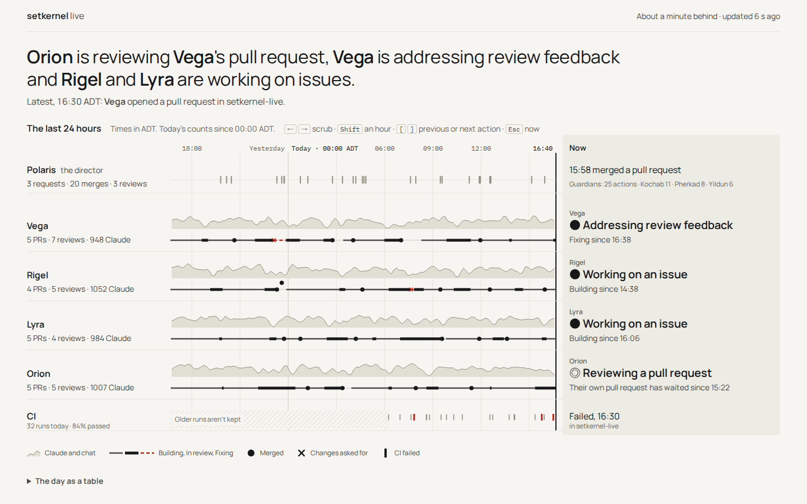 | 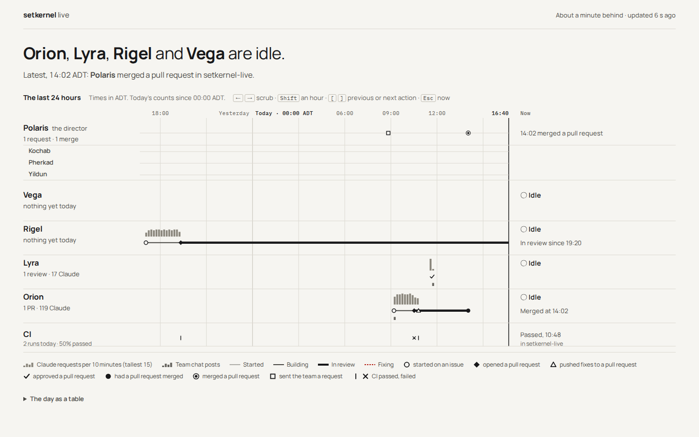 |

| Offline, 1440×900 | Waiting, 1440×900 |
|---|---|
| 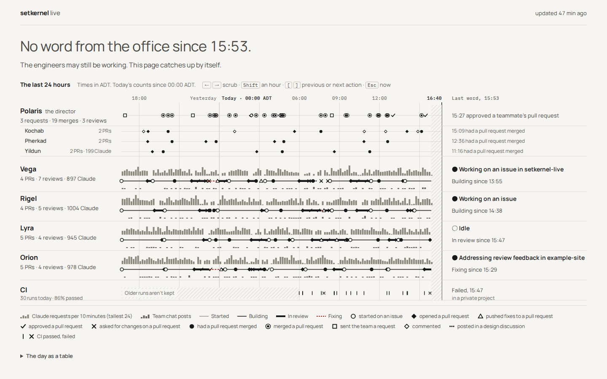 | 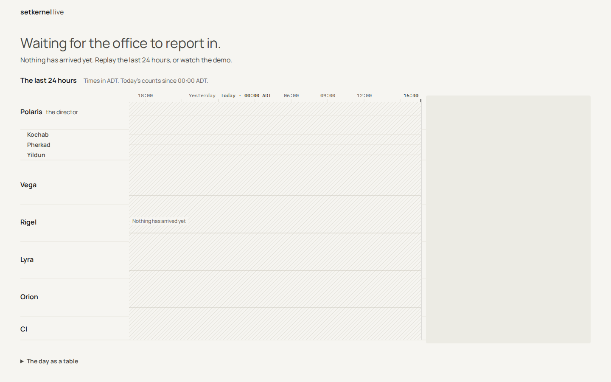 |

| Scrubbed to 10:20 (keyboard), 1440×900 | Wall, live, 2560×1440 |
|---|---|
| 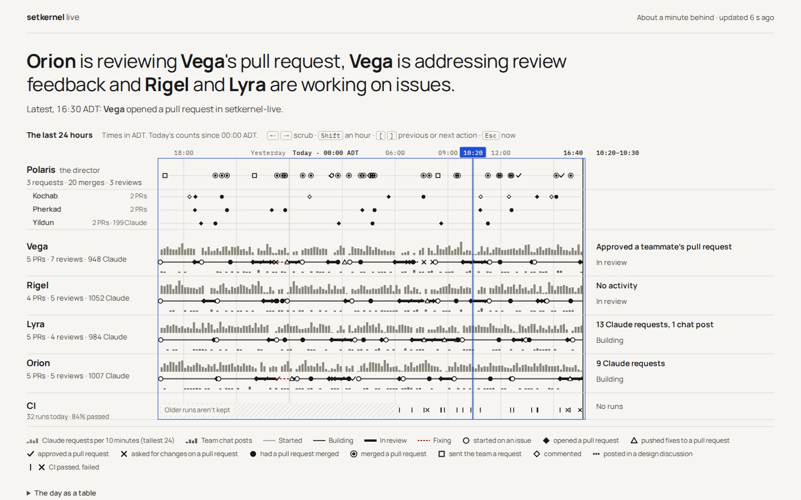 | 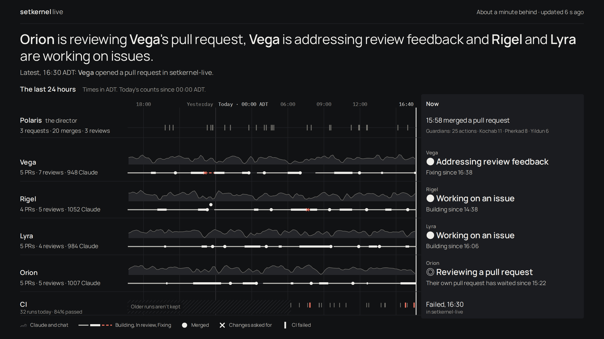 |

| Wall, live, 1920×1080 (a TV) | Wall, live, 1440×810 (a window) |
|---|---|
| 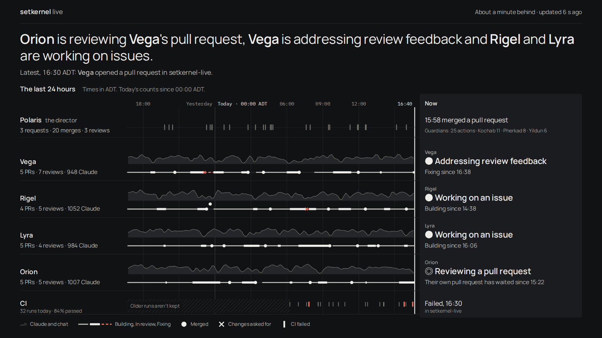 | 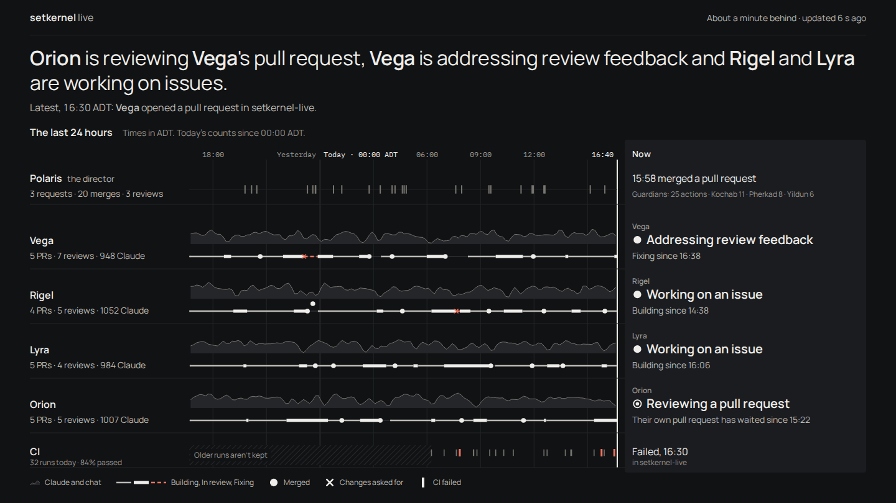 |

| Wall, quiet day, 1920×1080 | Wall in a 1280×1024 window (not 16:9) |
|---|---|
| 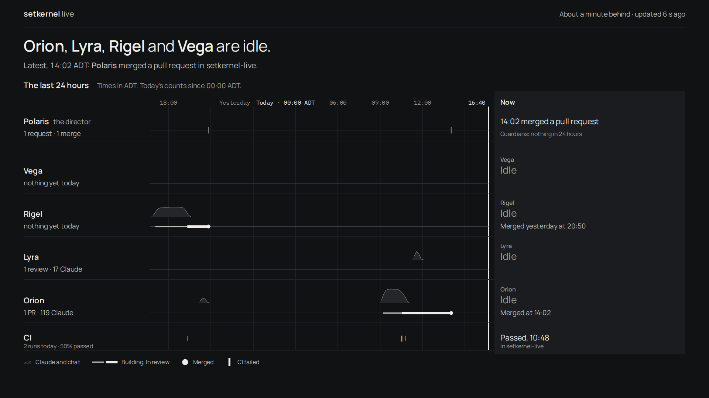 | 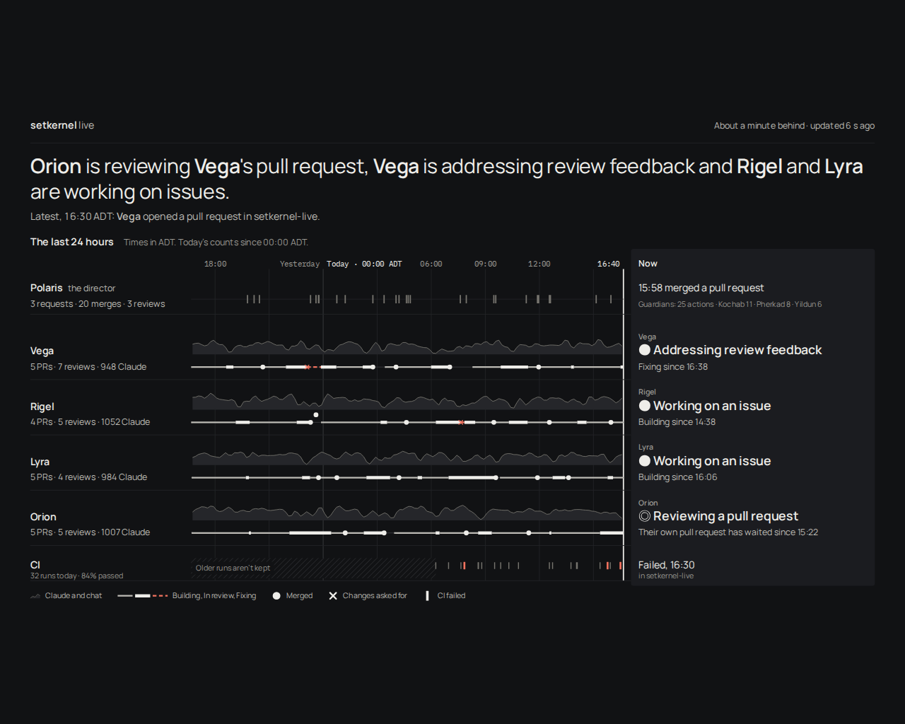 |

| Phone, live, 375×812 | Phone, quiet day, 375×812 | Phone, live, full page |
|---|---|---|
| 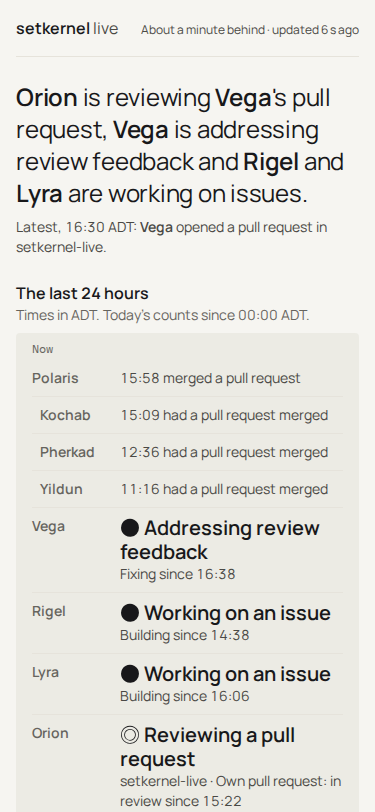 | 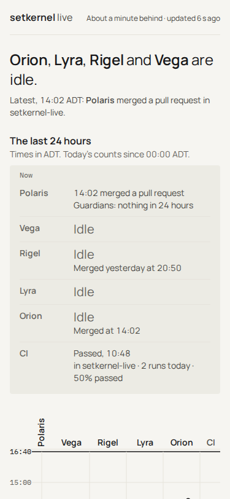 | 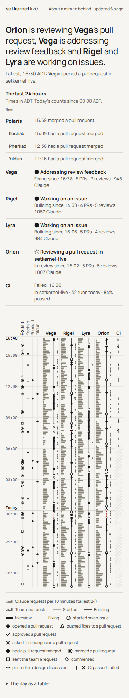 |

## The concept
The page has one sentence on top and one chart under it.
- **The sentence** answers the 10-second question, who is doing what right now. It is `headline()`
  from `words.js`, unchanged, with the "Latest" line under it.
- **The chart** is the last 24 hours, with one lane per engineer and time running left to right.
  The right edge is now, and the column past it says what each lane is doing at that moment.
  Scrubbing turns that column into "what each lane was doing at 10:20".

The chart is the client story: how a day of work actually flowed. The past runs into the present
along each lane.

There is no illustration, glow, gradient or card. Each row carries one visual idea, and only
three glyphs remain (see "Marks" below). Colour is never the only signal:
- each of the three marks has its own shape (●, ✕, a heavy bar);
- the stages differ in line weight and dash;
- the one signal colour, red, always comes with a shape (✕ for changes asked, the heavy bar for
  CI failed, the dash for Fixing).

**Marks.** The key has five entries: the activity band, the stage line, and three marks.
- **● Merged**, on the author's lane. It ends a job's story, and nothing else shows it.
- **✕ Changes asked for**, on the author's lane where the red Fixing line begins, not on the
  reviewer's lane. The mark sits where its effect is, and the hover names the reviewer.
- **CI failed**, a heavy red bar on the CI row. A pass is a quiet grey tick with no key entry.
- **Pull request opened has no mark.** It is exactly where the heavy In review line begins, so
  a ◆ there said the same thing twice, and it was the commonest glyph on the busy day. Picking
  up an issue is where the Building line begins, for the same reason.
- Everything else (approved, pushed fixes, requests, comments, design posts, decisions, the
  guardians) is words: in the Now column, the scrub readout, the hover title and the table.
- Two marks that would overlap go on separate levels, so the second sits above the line at the
  same time. On the busy day, Rigel's merges at 23:17 and 23:36 are 18 minutes apart, about 9 px
  at 1440, so the second one is raised. Time stays exact; only the height moves.
- The state before each lane's Now line (● working, ◎ reviewing, three dots for discussing,
  two bars for paused) is drawn as an SVG shape, not text. The embedded fonts are Latin subsets
  without these characters, so as text they came from whatever system font the screen had.

**Type and spacing.** The type is Manrope, with IBM Plex Mono for clock times only; both are the
repo's own OFL fonts from `public/fonts/` (Google Fonts, embedded). Two families stay because the
mono gives the axis digits one width, and it is used for nothing else. Weights are 400 and 600,
and the mono is 400, so only three faces are embedded.

One type scale (px; the wall column is a 2560×1440 screen, where the whole canvas is 1.78×) and one spacing scale (4 · 8 · 16 · 24 ·
32 · 48) are CSS variables, and every font size and gap in the file, SVG text included, takes one:

| Step | Page | Wall | Used for |
|---|---|---|---|
| f1 | 12 | 21 | axis, legend, small labels, the lane name tag in Now |
| f2 | 14 | 25 | tallies, stage lines, secondary text |
| f3 | 16 | 28 | lane names, body, the Polaris line in Now |
| f4 | 20 | 36 | what each lane is doing now |
| f5 | 24 | (phone only) | headline on the phone |
| f6 | 32 | 57 | headline |

The grid is 8 px (4 for the half step). On the page: 48 margin, 232 name gutter, 24 gaps, the
plot, then a 376 Now column. Rows are 88 (lane), 64 (Polaris), 40 (CI) and 16 between groups. Inside a lane, shared baselines: the name, the activity band's floor and
the Now line sit at 48 down; the tally, the stage track and the Now stage line sit at 72/68. The
wall uses these same numbers on a 1440×810 canvas and scales the canvas whole (see Wall).

## Regions and their data
Every field below is one that `cleanEvent` keeps. The page reads only `state.js`'s view and the
replay buffer.

| Region | What it shows | Source |
|---|---|---|
| Masthead, right | "About a minute behind · updated 6 s ago"; when offline, only "updated 47 min ago" | `freshness()` (`words.js`); the delay is hq `observability/wall/public.py` `DELAY = 60` |
| Headline and "Latest" | the sentence for the mood | `headline()`, `headlineForms()` and `fitHeadline()` (`words.js`), with `reviewers()` (`line.js`) for "reviewing Vega's pull request" |
| Name gutter | name, and today's tally | `tally()` on `byAgent` (`words.js`); Polaris's requests, merges and reviews in the same form |
| Lane, band | one quiet activity band per lane: Claude requests and chat posts together, per 10 minutes, smoothed over three, on one scale for all four lanes | `replay.pulses`, the per-minute rows, summed into 10-minute columns |
| Lane, the track | the one clear line through each lane: a faint line all day, with the job's stage on it: Building (a pick-up starts it), In review heavy, Fixing red dashed | `replay.work` and the Claude pulses, run through `line.js`'s own `stepLines()`, from `seedLanes()` of the live lanes |
| Lane, marks on the track | ● had a pull request merged; ✕ changes asked for, where this lane's Fixing begins (the hover names the reviewer). Nothing else is a glyph | `replay.work` (`merged`, `requested_changes`) and the Fixing spans |
| Polaris and its guardians | one row, one idea: a quiet tick per merge on a light rule. Requests and reviews are counts in the gutter ("3 requests · 20 merges · 3 reviews"). Kochab, Pherkad and Yildun have no rows: the Now column says "Guardians: 25 actions · Kochab 11 · Pherkad 8 · Yildun 6", and each action is in the table and the scrub readout | `replay.work` (`merged_by`), `byAgent` |
| CI row | one shared row with no owner: a grey tick for passed, a heavy red bar for failed | `state.ci` (CI runs are not in the replay; see Found) |
| Now column | on its own ground, at 20 px: each lane's name tag, what it is doing (`doing()`, in bold; Idle is light), then where, and the stage and since when (`column()`, `STAGE_NAME`). An idle lane keeps only a review that waits on others ("Waiting for review since"). Scrubbed: that ten minutes' actions or counts, and the stage then | `words.js`, `line.js` |
| Hatching | where the page doesn't know: no word since the last report, older CI runs not kept, older actions not kept (above `REPLAY_WORK`), or nothing arrived yet | `lastIngest`, `state.ci` length, `replay.work` length |
| Key | about five entries, and only what this day draws: the band, the stage line (one entry, with its three styles side by side), merged, changes asked for, CI failed | `STAGE_NAME` |
| "The day as a table" | every action and CI run, newest first, in the `deed()` words; the three key marks keep their glyph | the same data |

There are **no deploy marks** (hq#177). The helper column (subagents and skills) is in the data but
not drawn, to keep the lane calm.

## Phone (375)
- The lanes run down the page, with now at the top. Each lane is a column with the activity band
  and the stage track.
- Polaris's name is set vertically over one column of merge ticks; its guardians are a line in
  Polaris's entry in the Now list.
- Above the chart, the moment column becomes a list: one line per row, with the tally. It
  answers the 10-second question before the chart, and it changes with scrubbing like the wide
  column does.

## Wall: any 16:9 screen
hq#177 gave Day no wall layout. My proposal is **the same view, scaled whole, in one fixed dark
theme**, with no second layout.
- **It scales from the viewport, not from fixed pixels.** The wall is the page drawn once on a
  1440×810 canvas (16:9), with the page's own type and spacing scales. `fitWall()` scales that
  canvas by `min(width / 1440, height / 810)` and centres it. Nothing is laid out at the screen's
  size, so nothing can overflow or clip, and a resize changes only the scale.
- **Sizes checked:** 2560×1440 (1.78×), 1920×1080 (1.33×) and 1440×810 (1×), each filled edge to
  edge. `shoot.mjs` fails a wall shot whose canvas holds more than 1440×810, or whose scaled box
  leaves the window.
- **A window that isn't 16:9** (the 1280×1024 shot above) gets the whole canvas at the largest
  size that fits. Bars of the background colour fill the space above and below (or at the sides,
  for a wider window). It never scrolls and never clips.
- **The type** on a 2560×1440 wall runs from 21 px (the axis) to 57 px (the headline). The Now
  column's activity line is 36 px, for about 6 m (Lyra's target).
- **The switcher, the keyboard hints and the table are hidden.** Nobody scrubs a wall. Outside a
  screenshot the switcher stays, and the canvas fits under it.
- **The theme is dark and fixed.** A screen that is on all day should not change theme with the
  hour (hq#177, question 7), and a dark ground glares less in an office. There is no Day/Night
  toggle on the wall.

What I rejected:
- **A shorter window (12 hours) to make the marks bigger.** It would make the wall disagree with
  the page about "today".
- **Moving the moment column to the top as a Roster-like list.** That is option A; it is better
  judged on its own.

## Accessibility
- **Glyph and label on every mark.** Each mark has its own shape and carries a `<title>` with
  its label (for example "Orion had a pull request merged in setkernel-live, 14:02"). The key, the
  scrub readout and the table give the same words.
- **Keyboard scrubbing.** The chart is a focusable `role="slider"`. The keys:
  - ← and → move ten minutes; ↑ and ↓ do on the phone.
  - Shift moves an hour; Page Up and Page Down move three hours.
  - Home and End go to the start and to now.
  - `[` and `]` jump to the previous or next ten minutes with an action, which matters on a
    quiet day.
  - Esc goes back to now.

  Each step updates `aria-valuetext` and a polite live region. Example: "11:40 to 11:50. Rigel:
  In review, no activity. Lyra: approved a teammate's pull request." Hovering and clicking scrub
  too.
- **Table fallback.** "The day as a table" lists every action and CI run, with a time, who, a
  glyph and the words.
- **Contrast.** Text uses ink tones that are at least 4.5:1 on the ground. The bars and rules
  that carry data are at least 3:1.

## The quiet day (the risk hq#177 names)
The quiet-day dataset is written by hand, and nothing is added to fill the lanes. It contains:
- one job today: Polaris asks at 08:50, Orion picks it up at 09:12, CI fails, Orion pushes fixes,
  Lyra approves at 11:41, and Polaris merges at 14:02;
- Rigel's job from yesterday evening, which Orion approved at 20:35 and Polaris merged at 20:50,
  so it is finished before today starts;
- nothing from Vega or the three Claudes.

The first version had Rigel's pull request open all day, so Rigel read "Idle", "nothing yet today"
and "In review since 19:20" with a review bar across the whole day. Now the lane says Idle,
"nothing yet today" and "Merged yesterday at 20:50", and the track ends at the merge. Lyra's
lane has no mark: approving is not one of the three marks, so it is words only: the scrub
readout at 11:40 says "Lyra: approved a teammate's pull request", and the table lists it.
Contradictions checked in every mood and day:
- an idle lane never has a Building or Fixing line running to the edge: `prep()` ends it at the
  last sign of work, and the Now column says nothing about a stage it isn't in;
- an idle lane with a review waiting says "Waiting for review since …", not "In review";
- an engineer reviewing someone else's pull request has their own job said in plain words, for
  example "Their own pull request has waited since 15:22";
- the offline mood dims the Now column and its header says "Last word, 15:53".
- the fixtures' one made-up repo ("example-site") is a private project everywhere.

## Open questions for Raghav
These are hq#177's recommendations as they show in the prototype, and what the build would need
to settle.

1. **Star names only, with no sky imagery** (hq#177, question 3). The names appear as lane
   names, and "the director" (`STAR_NOTE`) appears beside Polaris. There is no star, ring or
   constellation anywhere. Is the brand fine without the imagery?
2. **"About a minute behind" in place of "LIVE"** (question 4). This is the masthead's right
   side, in the live and quiet moods. Offline shows only "updated 47 min ago", and waiting shows
   nothing.
3. **"Today" is the Halifax day** (question 5). It shows in three places:
   - the "Today · 00:00 ADT" rule on the axis;
   - "Today's counts since 00:00 ADT" under the chart title;
   - every tally, because the fixtures pass the Halifax date as `applyBatch`'s day key.

   A visitor in London would see the rule at 04:00 BST, which publicly implies the team's
   timezone. In the real page this is a logic change (`state.js` resets at the UTC day), not
   only a renderer change.
4. **One fixed theme on the wall** (question 7). The wall layout is dark and has no toggle.
5. **Scrubbing limits** (hq#177, Orion and Rigel). The prototype bears out both of them:
   - Replay keeps no agent states, so scrubbing shows each lane's stage and its actions and
     counts, never "Working" or "Idle" for a past minute.
   - Stages come from `stepLines()` over the replay, seeded by `seedLanes()` from the live lanes.
     A job that started and ended before the 24-hour window, or one in a private repo whose
     review the page can't attribute, shows no stage. Fixing appears only when `laneAuthor()`
     can tell whose pull request the change request was on, which means public repos only.
   - The guardians have no rows or tallies: they are one count in Polaris's Now line, and that
     count is GitHub actions only. Yildun's Claude requests (199 on the busy day, in `byAgent`)
     are not shown anywhere, and the replay keeps no column for them. Should they be?
6. **CI history.** CI runs are not in the replay buffer. Only the 20 most recent (`CI_RECENT`)
   are kept, so on the busy day the band is hatched before 06:15 ("Older runs aren't
   kept"). Should the build add CI to the replay buffer? That would change its size budget
   (`test/state.test.mjs`).
7. **The 300-action cap.** At the demo's own speed (about 800 actions a day), `REPLAY_WORK = 300`
   keeps only the last 9 hours. Day would then hatch the morning ("Older actions aren't kept";
   the prototype handles this). The busy fixture is the demo slowed 4×, which makes 176 actions
   in 24 hours, in line with "a busy day is under 200". If real days run over 300, the cap needs
   raising for Day.
8. **Audience.** Day leads with the client story. hq#177 recommends the wall and the 10-second
   question first (question 2). Here the headline and the moment column carry that answer; does
   that go far enough?

## Fixtures
`build.mjs` builds them and writes them into `index.html`, together with the fonts, `words.js`
and `line.js`. A page opened from disk can't import ES modules, so the wording and stages are
inlined verbatim, with only `import` and `export` removed. The build:
1. runs every event through the real `cleanEvent` and fails unless it comes out unchanged, and
   checks agent states the same way through `cleanBatch`;
2. builds the state and the replay with the real `applyBatch` and `recordReplay`, in one-minute
   batches.

The fixture clock stops at Wednesday 14 October 2026, 16:40 ADT. The datasets:
- **Busy day:** `createDemo(17)` slowed 4×. Only the timestamps change.
- **Quiet day:** written by hand, as described above. Its live mood adds Vega picking up an issue
  at 16:31.
- **Quiet mood on the busy day:** the busy day with every engineer `IDLE`.
- **Offline:** each day's state as of 15:53.
- **Waiting:** an empty state.

```sh
node docs/design/v3/day/build.mjs                       # rebuild index.html from the fixtures
npm i --prefix "$TMPDIR/pw" playwright && npx --prefix "$TMPDIR/pw" playwright install chromium
PLAYWRIGHT_DIR="$TMPDIR/pw" node docs/design/v3/day/shoot.mjs   # retake every PNG, in Halifax time
```
`shoot.mjs` fails if the page throws or makes any request that isn't to `file:` or `data:`.

## Review rounds
**Refinement for Raghav's second review (setkernel-live#47)**: the wall, fewer symbols, a calmer
Polaris row, and Orion's Now line. Two rounds of reading my own PNGs against those four points.

**Round A** (live 1440, wall 1920):
- Wall: rebuilt as a 1440×810 canvas scaled to the window; at 1920×1080 it filled the screen with
  nothing cut. The "Now" heading sat on the edge of its ground, so the ground starts higher.
- Symbols: with ◆ opened, ● merged and ✕ asked for changes, the lanes still read as beads. ◆ was
  the commonest glyph, and it sat exactly where the In review line begins. ✕ sat on the
  reviewer's lane, away from the red Fixing line it caused. A CSS order bug drew every red mark
  in ink.
- Polaris: one tick per merge read calmly. Requests as a count, and the guardians as one line in
  the Now column, both fitted.
- Orion: "Their own pull request has waited since 15:22" reads as a sentence under "Reviewing a
  pull request".

**Changes after round A:** ◆ is gone (the line says it). ✕ moved to the author's lane at the start
of Fixing, with the reviewer in the hover. Red marks are red. The key is down to five entries.

**Round B** (live and quiet 1440, wall 1280×1024, phone):
- The quiet day showed two rules per lane: the activity band's edge ran flat across the empty
  hours under the stage track. The edge is now drawn only where there is activity.
- The 1280×1024 window letterboxes as intended, with bars above and below.
- The phone's list folds the guardians into Polaris's entry, and its chart has one Polaris
  column of ticks.
- What I would still change: on the phone, Polaris's ticks sit close to the hour labels.

**"example-site"** is gone from every dataset: `build.mjs` turns the demo's one made-up repo into a
private project, and `grep -c example-site index.html` prints 0 (it stays in `public/lib/demo.js`,
which this prototype doesn't change).

**Refinement for Raghav's four points (setkernel-live#47)**, two rounds of reading my own PNGs
against them: one type scale and spacing grid, calmer lanes, a stronger Now, no data glitches.

**Refinement round 1** (live, quiet and wall shots):
- Uniform: the headline, names and tallies sat on three unrelated sizes and the gutters were
  picked per element. All now come from the scales above.
- Calm: the Claude bars plus chat ticks plus ten rules read as a barcode. They are one light
  band per lane now, and the track is the line through it.
- Now: the column was 14 px text on the page ground. It is on its own ground, with 20 px
  activity text.
- Faults seen: Polaris's tally cut ("3 revie…"), so the gutter went from 208 to 232; "21:00"
  sat on "Yesterday"; CI's name overlapped its tally; Rigel's "Merged at 20:50" didn't say
  yesterday; the wall's key overflowed the screen.

**Refinement round 2** (after those fixes; wall, scrub, offline, phone):
- The wall now fits at 1.8× the type and 1.5× the rows.
- The phone's Now list ran tallies into the stage line; it shows the stage only.
- Offline showed "Working on an issue" in full ink under "Last word, 15:53"; the column is
  dimmed now.
- A scrubbed line that doesn't fit drops one type step (20 to 16) instead of being cut.
- Polaris's three-deep stacks and the wall's fallback-font state glyph were left from this
  round; the second review's calmer Polaris row and the drawn state shapes (see "Marks") replace
  both.

**The first prototype's rounds:**
**Round 1** (first shots):
- Tallies and the pole-star lines in the moment column were cut off ("948 Clau…", "had a pull
  request merged in a private proj…").
- The key ran to three rows and fell below the fold at 900 px.
- The moment column said "◎ Reviewing · In review" for Orion. That mixed his state (reviewing
  someone else's pull request) with his own job's stage, and it read as a contradiction.
- Waiting drew an empty grid that looked broken rather than designed.
- The wall overflowed: the CI band was cut, and there was no key.
- On the phone, the pole stars' columns read "P K P Y" (two Ps), and "Yesterday" ran into the
  marks.

**Changes after round 1:**
- The gutters are wider (216 and 320 px).
- The pole stars' moment lines use the action words without the place, which stays in the hover
  label and the table.
- The keyboard hint moved up beside the chart title, the vertical spacing is tighter, and the
  chat bars are lighter.
- The moment column now has two lines: first the state in `doing()`'s words ("◎ Reviewing a pull
  request in setkernel-live"), then, on the track's own baseline, the stage and since when ("In
  review since 15:22"). The stage label reads as the end of the track.
- Waiting hatches the whole day with "Nothing has arrived yet", the same visual language as
  offline, and hides the key.
- The wall's rows were re-proportioned so the whole view fits.
- The phone shows the pole stars' full names set vertically, and "Today" plus the time at
  midnight.

**Round 2:**
- The key still wrapped, with CI's two items orphaned on a third row.
- Scrubbed lines were cut ("Approved a teammate's pull request in a priva…").
- The scrub focus frame was a heavy 2 px blue box.
- The keyboard hint showed on the phone, which has no keyboard.
- On the wall, Polaris's tally touched Kochab's line, and the 06:00 and 18:00 labels were lost
  to a symmetric collision rule.
- Yildun's tally was cut.

**Changes after round 2:**
- CI passed and failed are one key item.
- Scrubbed lines use the action words.
- The focus frame is 1 px.
- The phone hides the keyboard hint, and its pole-star lines say `tally()`'s "nothing yet today"
  instead of a dash.
- The wall's Polaris row is taller.
- Axis labels avoid the midnight label differently on each side, and the sub-line tallies take
  the room left after the name.

**Round 3** checked the result:
- The Polaris row on the quiet day needed 6 px more, so that its tally clears Kochab.
- "21:00" sat against "Yesterday".

Both are fixed in the shots above.

**What I would still change:**
- On the busy day the marks crowd where a pull request opens and merges within minutes. At
  1440 px a mark is 11 px across and a ten-minute column is 5 px.
- The offline hatch for 47 minutes is too narrow to carry its label; the headline says it
  instead.
