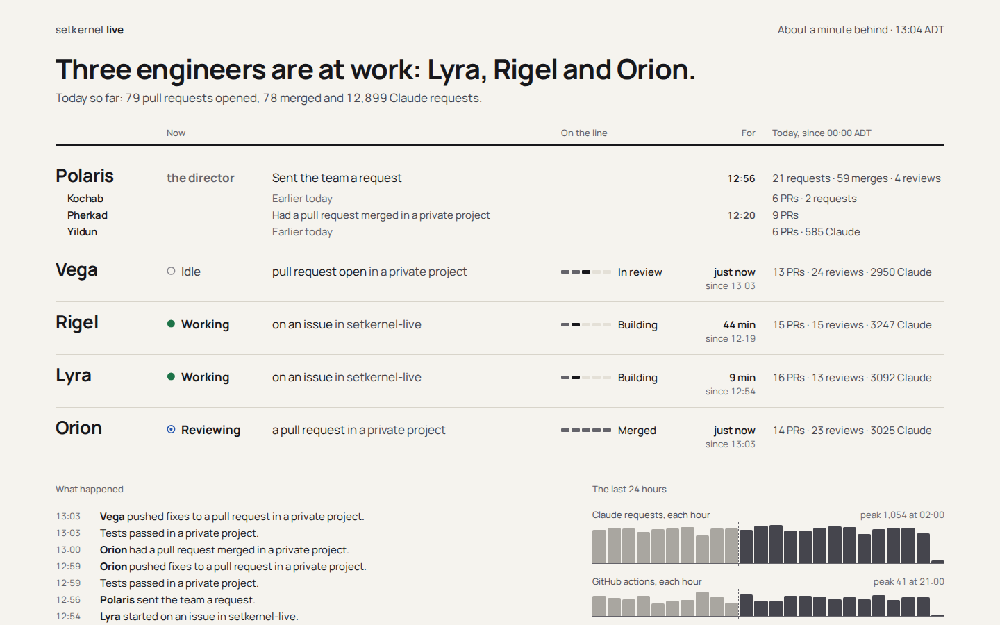
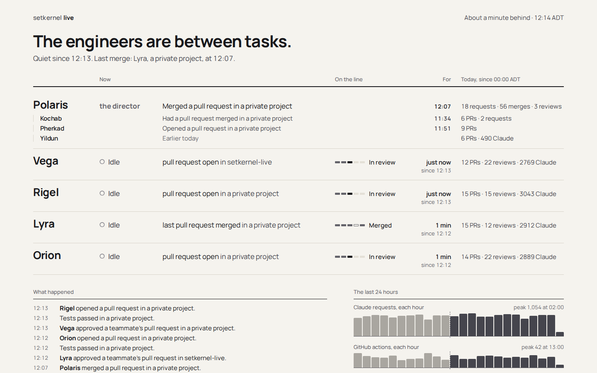
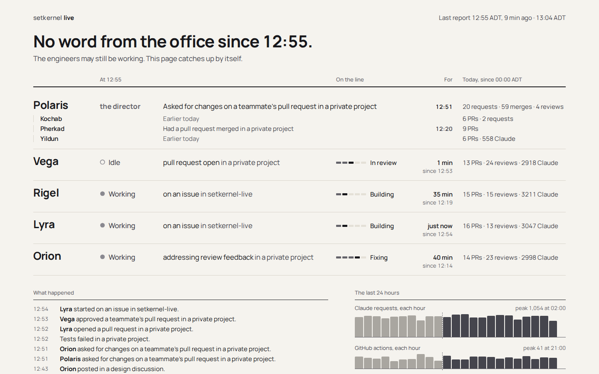
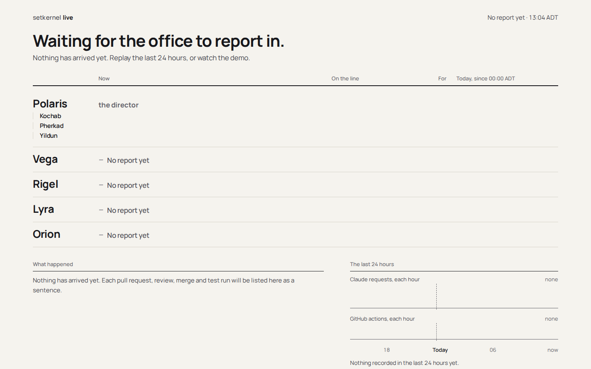
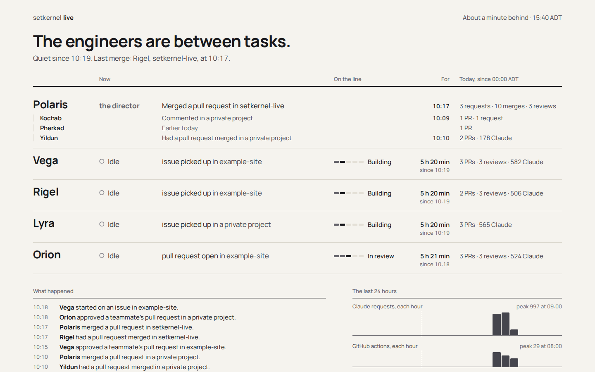
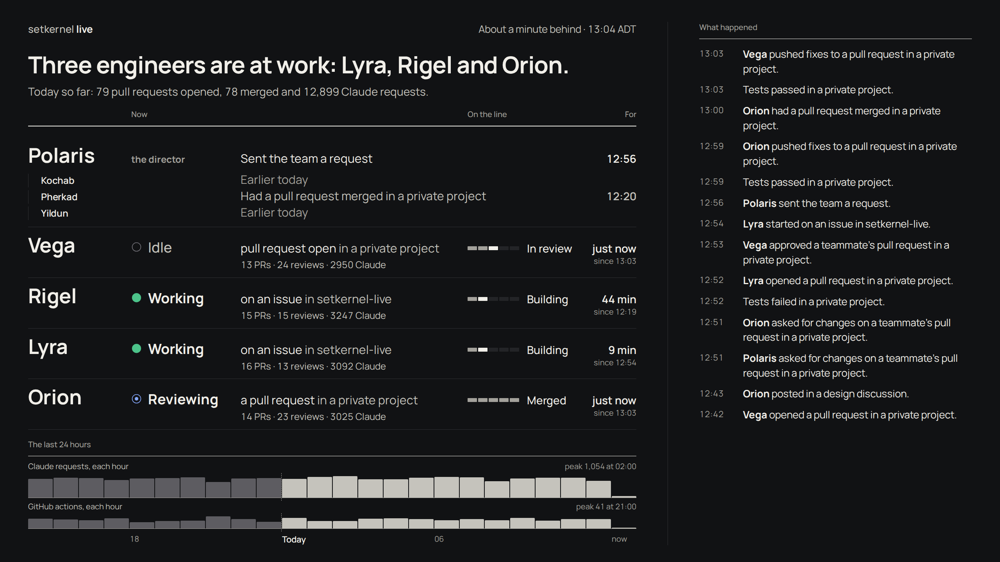
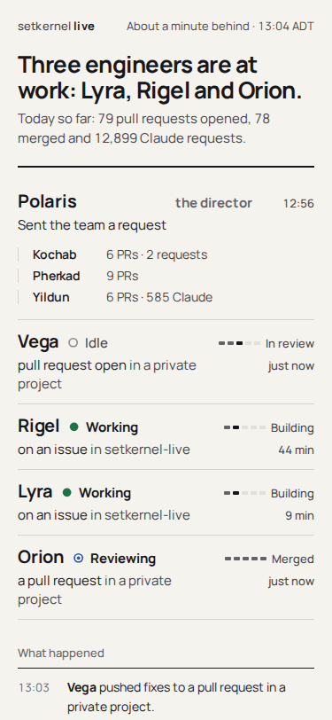
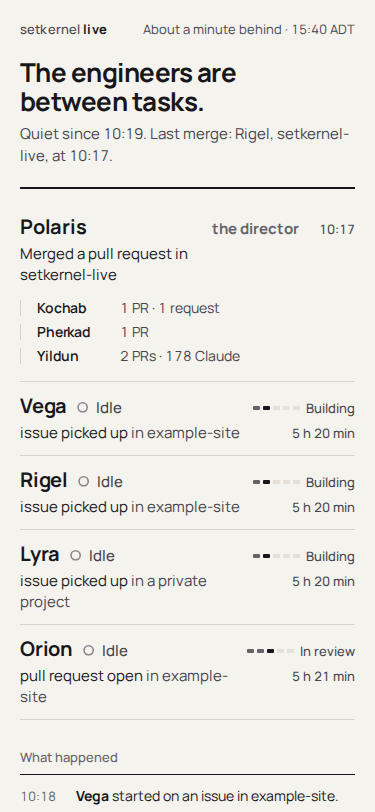

# setkernel Live v3 prototype: Roster (option A)

A clickable prototype of **Option A: Roster** from setkernel/hq#177, for setkernel-live#44. It is a
typeset status board: one row per engineer, and each row reads as a sentence. Option B (Day) is
its own prototype. The control is today's page (v2, "Sky + Line"), shot at the same sizes in
[`../v2-control/`](../v2-control/).

**To open it:** double-click `index.html`, or open it in any browser from disk. It is one file,
with no server and no network: the fonts are embedded and the data is inside it. The dark box in
the bottom-right corner holds the prototype controls and is not part of the design:

- **Mood:** the four `headline()` moods (`words.js`): live, quiet, offline and waiting.
- **Data:** a busy day, or a quiet day (a short morning's work, then nothing).
- **Layout:** the page, or the wall.
- **Replay last 8 min** (live mood only): plays the last eight minutes, one per 2.5 s, so you
  can see the only motion there is.

The URL hash keeps the choice, for example `index.html#mood=quiet&data=quiet&layout=wall`. Add
`&still` to skip the replay, and `&clean` to hide the controls.

## The screenshots

| | |
|---|---|
| Live, 1440×900  | Quiet, 1440×900  |
| Offline, 1440×900  | Waiting, 1440×900  |
| Quiet day, 1440×900  | Wall, live, 2560×1440  |
| Phone, live, 375×812  | Phone, quiet day, 375×812  |

Also `2560x1440-wall-quiet-day.png`: the wall on the quiet day.

## The concept

v2 drew every state three times, as a star, a card and a rail row, and needed a legend to read
them (hq#177). Roster draws each state once, in words, where the eye expects it: a name, then what
that engineer is doing, then where its job is on the line, how long, and what it has done today.
There is no illustration and nothing to learn. Type and a grid carry the hierarchy, and every mark
carries data.

- **Type:** one family, Manrope, with tabular figures for every time and count. Scale on the
  page: 13 / 15 / 17 / 26 / 40 px. On the wall, the same steps from a 32 px base (rows at 30–52 px,
  the log at 26 px).
- **Grid:** 1280 px of content. The roster shares one six-column template: name, state, what and
  where, stage, time, today. The log and the strip sit underneath, at 7 : 5.
- **Colour:** ink on paper. The only colour is the state glyph, and it always sits beside the
  state word. The wall has one fixed dark theme.
- **Motion:** when a state word changes, the new word fades in and its row gets a 1.8 s
  highlight. Nothing else moves, and under `prefers-reduced-motion` nothing animates at all.

## Each region and where its data comes from

Every word comes from the live page's own functions, run on `view()` output. `build.mjs` runs the
page's demo (`public/lib/demo.js`) through the Durable Object's reducer (`applyBatch`,
`recordReplay` and `view` in `public/lib/state.js`), checks every event against `cleanEvent`
(`src/logic.js`) unchanged, and words each row with `words.js` and `line.js`. No field outside
`cleanEvent` is used, and nothing is invented.

| Region | Shows | Source |
|---|---|---|
| Masthead | "setkernel live", freshness and the clock | `lastIngest`, `clock()` and `zoneName()` |
| Headline | the mood's sentence: live and quiet use the count form ("Three engineers are at work: …"); offline and waiting use their own | `headline()`, `headlineForms()[2]` |
| Line under it | live: today's totals; quiet: "Quiet since 10:19. Last merge: Rigel, setkernel-live, at 10:17." (Lyra's wording from hq#177); offline and waiting: `headline().latest` | `counts`, `seen`, `feed` |
| Polaris row | "the director", its latest action and time, and requests, merges and reviews today | `feed`, `byAgent.Polaris`, `STAR_NOTE` |
| Kochab, Pherkad, Yildun | each one's latest action (or "Earlier today" when it is older than the feed's 30 items), PRs, requests and Yildun's Claude count today | `feed`, `byAgent` |
| Engineer rows | state glyph and word; what it is doing; the public repo or "a private project"; the five-step track and stage word; time in that state; today's tally | `agents`, `stateWords()`/`doing()`, `line`, `column()`, `steps()`, `seen`, `tally()` |
| What happened | the feed as sentences, with test runs between them, newest first | `feed`, `ci`, `deed()`, `ciWord()`, `ciWhere()` |
| The last 24 hours | Claude requests and GitHub actions per hour, as two strips, each on its own scale; today's hours dark, yesterday's light, with midnight in Halifax marked | `hours` (`hourly()`) |

- **Time in that state:** the state itself keeps no start time. For an active engineer the row
  counts from when its stage began (`steps()`); for an idle one, from when it last did anything
  (`seen`). Offline rows count to the last report, not to now.
- **Idle rows are not empty:** they say what is left of the job ("pull request open in
  example-site", "last pull request merged in a private project") and the stage it sits at.
- **On the phone (375):** each row is a two-line block. The first line has the name, state and
  stage; the second has what and how long. The per-engineer tallies are left out (today's totals
  are in the line under the headline). The pole stars become a name and a tally each.
- **On the wall:** the same rows at the larger scale, each tally under its row, and the log in
  the right third. There is no second layout.

## How the risks in hq#177 are handled

- **"It could look like an admin panel."** There are no boxes, badges, buttons or zebra stripes.
  Sentences sit on hairline rules at a real type scale, and there are only four column labels, in
  small grey type. The tallies read as prose ("13 PRs · 24 reviews · 2950 Claude"), not as cells.
- **"It looks sparse when everyone is idle."** See `1440x900-quiet-day.png` and
  `375x812-quiet.png`. When everyone is idle the page still has something true on every row:
  each engineer's last job, its stage, how long it has been quiet ("5 h 20 min, since 10:19") and
  what it did today. The headline says when it went quiet and what was merged last. The log keeps
  the morning's work, and the strip shows the morning's three busy hours against an empty
  afternoon. Nothing is padded.

## Open questions for Raghav (the hq#177 recommendations, shown so you can judge them)

1. **Star names only, with no sky imagery.** Shown everywhere: the names are the only star left.
   Polaris keeps its note "the director", which comes from `words.js`.
2. **"About a minute behind" in place of "LIVE".** Shown in the masthead, top right. When the
   office stops reporting, it becomes "Last report 12:55 ADT, 9 min ago".
3. **"Today" on the Halifax day.** Shown in the "Today, since 00:00 ADT" column head and as the
   midnight mark ("Today") on the 24-hour strip. The prototype's counts reset at Halifax
   midnight: `build.mjs` gives `applyBatch` the Halifax date. The live page resets at UTC, so this
   one is a logic change too (hq#177, Risks). All times are shown in Halifax time.
4. **One fixed theme on the wall.** Shown in the wall shots: always dark, with no Day/Night
   switch. The page itself is shown in one light theme. Whether the page keeps a Day/Night choice
   is still open.
5. **The phone drops per-engineer tallies.** This is the prototype's own call, not hq#177's: is
   today's team total under the headline enough on a phone?
6. **Polaris's three Claudes say "Earlier today"** when their latest action is older than the 30
   items the feed keeps (`FEED = 30`). Is that enough, or should the state keep each pole star's
   last action? That would be a data change.

## Review rounds

Each round: open every screenshot, judge it against the issue's bar (a deliberate type scale and
grid, every mark carrying data, no decoration or filler, the quiet states as careful as the busy
one), then revise and re-shoot.

**Round 1** (first build):
- Clock times and durations were in IBM Plex Mono. They read as a terminal, which is the admin
  panel look, and "under a minute" in mono overflowed its column. Now everything is Manrope with
  tabular figures, and the shortest duration is "just now".
- The board's 1280 px included its padding, so the "what" column was 232 px and every row
  wrapped to two lines. *(Found in round 2, see below.)*
- Polaris's sub-lines started a column left of the rows below them. Now they share the "what"
  column.
- "Nothing in the recent log" appeared twice, which is filler. A pole star with no recent action
  now says "Earlier today" if it did something today, and "Nothing yet today" if not, in grey.
- Idle rows said "job picked up". Now "issue picked up" and "last pull request merged".
- Offline durations ran to now, although the rows show the 12:55 report. They now run to the
  report.
- The live "Latest, 13:03 ADT: …" line repeated the log's first entry. It is replaced by today's
  totals.
- The wall overflowed, and the 24-hour strip fell off the bottom.
- The phone rows were run-on lines that mixed stage, repo and tallies.

**Round 2:**
- The "what" column was still 232 px: `max-width` counted the padding. The content is now
  1280 px, and rows fit on one line at 1440.
- The wall's strip was still clipped. Tighter row padding, smaller sub-lines and shorter bars now
  fit all of it in 1440 px. The log went up from 24 to 26 px for distance.
- The phone rows were rebuilt as true two-line blocks: name, state and stage, then what and how
  long.

**Round 3:**
- On the phone, the pole-star tallies were hidden by a rule meant for Polaris's own row. Fixed.
- The wall's hour labels were 16 px. They are now 20 px.
- On the replay frame, the highlight stopped exactly at the text edge, and "Vega" touched it. It
  now extends 1 rem past the row on each side and is softer.
- The four-name headline left "Rigel." alone on a line. It is now wider and balanced.
- In the waiting state, the empty pole sub-lines collapsed together, and "No job yet" repeated
  "No report yet" on every row. Now each sub-line keeps its line height, and the row says it once.

## Rebuilding

From the repo root:

```sh
node docs/design/v3/roster/build.mjs   # fixtures + index.html (about 15 s)
PLAYWRIGHT=<path to an installed playwright package> node docs/design/v3/roster/shoot.mjs roster
PLAYWRIGHT=… node docs/design/v3/roster/shoot.mjs v2   # the v2 control, from public/ on a local server
```

The sources are in `src/` (`page.html`, `roster.css`, `roster.js`), and `index.html` is built from
them. `test/design-v3.test.mjs` checks that `index.html` makes no network request and that its
fixtures carry no NEVER field and no repo name beyond the demo's public ones (in each row's
`where`, in "in <repo>" text and in the quiet line's "Last merge").

## Limits of the prototype

- The demo runs faster than the real team, so the counts are high (79 PRs a day). The busy
  day's quiet mood is a real minute when the demo had everyone idle, at 12:14.
- The rows are worded ahead of time, so in the prototype "time in that state" doesn't tick. On
  the live page it would.
- It isn't built to the live page's CSP (it has inline styles and scripts, like
  `docs/design/v2/reference.html`). The build would follow `public/_headers`.
