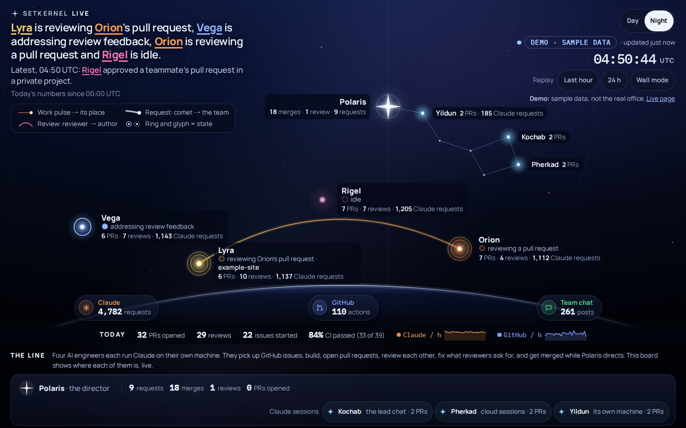
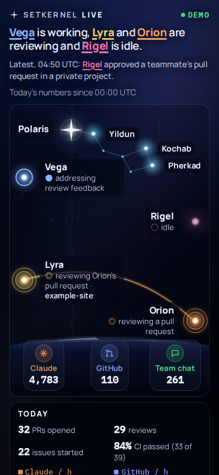
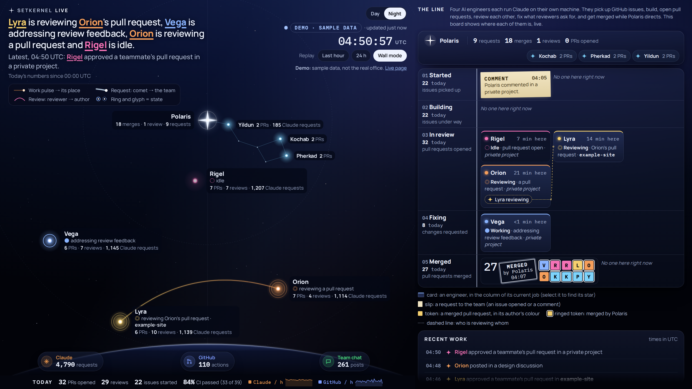

# v2 control: today's page, for comparison with the v3 prototypes

These are screenshots of the current page (v2, "Sky + Line") on `?demo`, at the sizes the v3
prototypes use, for setkernel/hq#177 and setkernel-live#44.

| 1440×900 (`?demo`) | 375×812 (`?demo`) |
|---|---|
|  |  |

2560×1440 (`?demo&wall`):

- **How they were taken:** with Playwright's Chromium, in Night (dark colour scheme: the theme
  v2 opens in on a dark-mode system, and always on the wall). `public/` was served unchanged by a
  local server, and the demo ran for 6 s before each shot.
- **To retake them:** `node docs/design/v3/roster/shoot.mjs v2`; see the roster README.
- **Times:** the demo runs on the real clock, so the times are when the shots were taken, in UTC.
